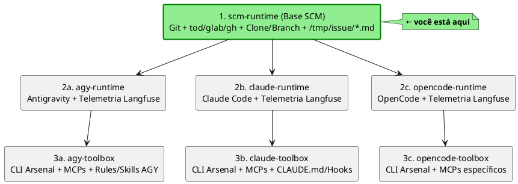

# scm-runtime

Container Docker que, ao ser iniciado, clona um repositório Git especificado por variáveis de ambiente e, opcionalmente, baixa os dados de uma *issue* (GitHub, GitLab ou OneDev) para gerar markdowns em `/tmp/issue/`. Também oferece um **modo autônomo** que executa um comando, captura seu stdout e comenta o resultado na issue.

## Variáveis de ambiente

| Variável            | Obrigatória? | Descrição                                                                                                        | Exemplo                              |
|---------------------|--------------|------------------------------------------------------------------------------------------------------------------|--------------------------------------|
| `GIT_SERVER_TYPE`   | Sim          | Tipo da forja: `onedev`, `gitlab` ou `github`.                                                                   | `onedev`                             |
| `GIT_REPO_URL`      | Sim          | URL HTTPS do repositório Git a ser clonado.                                                                      | `https://github.com/org/repo.git`    |
| `GIT_TOKEN`         | Sim          | Token de acesso à forja (personal access token ou API token).                                                    | `xyz--zzz`                           |
| `GIT_USERNAME`      | Opcional     | Usuário usado pelo helper de credenciais (default `git`).                                                        | `git`                                |
| `GIT_BASE_BRANCH`   | Sim          | Branch base que será clonado antes de mudar para a branch de trabalho.                                           | `main`                               |
| `GIT_BRANCH`        | Sim          | Branch de trabalho (ou `issue/<ID>` quando `ISSUE_ID` está definido).                                            | `agent/minha-tarefa`                 |
| `GIT_USER_NAME`     | Sim          | Nome de usuário Git a ser configurado no container.                                                              | `MyAgent`                            |
| `GIT_USER_EMAIL`    | Sim          | Email de usuário Git a ser configurado no container.                                                             | `myagent@example.com`                |
| `GIT_CO_AUTHOR`     | Opcional     | Co‑autor a ser adicionado a cada commit (formato `Name <email>`).                                                | `Some human <somehuman@example.com>` |
| `ISSUE_ID`          | Opcional     | ID da issue a ser baixada; habilita o modo de geração de markdowns.                                              | `123`                                |
| `AUTONOMOUS_MODE`   | Opcional     | Quando `true`, o container roda o agente (comando passado como argumentos), captura o stdout e comenta na issue. | `true`                               |
| `MAX_COMMENT_CHARS` | Opcional     | Número máximo de caracteres enviados para a issue (default `60000`).                                             | `50000`                              |

### Exemplo de arquivo `.env` comentado

```dotenv
# Tipo da forja (onedev, gitlab ou github)
GIT_SERVER_TYPE=onedev

# URL do repositório que será clonado
GIT_REPO_URL=http://onedev.uaiso.lan/demo-test.git

# Token de acesso à forja
GIT_TOKEN=<YOUR_TOKEN>

# Usuário usado pelo helper de credenciais (padrão: git)
GIT_USERNAME=git

# Branch base que será clonado inicialmente
GIT_BASE_BRANCH=main

# Branch de trabalho ou, se ISSUE_ID estiver definido, será sobrescrito por `issue/<ID>`
GIT_BRANCH=agent/minha-tarefa

# Identidade Git configurada no container
GIT_USER_NAME=MyAgent
GIT_USER_EMAIL=myagent@example.com

# Co‑autor opcional para os commits (formato "Nome <email>")
GIT_CO_AUTHOR=Some human <somehuman@example.com>

# (Opcional) ID da issue a ser baixada e convertida em markdown
# ISSUE_ID=123

# (Opcional) Executar em modo autônomo: roda o agente, captura stdout e comenta na issue
# AUTONOMOUS_MODE=true
```

## Como construir a imagem

```bash
docker build . -t scm-runtime:latest
```

## Como executar o contêiner

### Uso básico (apenas clonar o repositório)

```bash
docker run --rm -it \
  --env-file ./env/demo-test.env \
  scm-runtime:latest
```

### Executar um comando dentro do container

```bash
docker run --rm -it \
  --env-file ./env/demo-test.env \
  scm-runtime:latest bash -c "git status && ls -R"
```

### Modo “autônomo” com *issue*

```bash
docker run --rm -it \
  --env-file ./env/demo-test.env \
  --env ISSUE_ID=1 \
  --env AUTONOMOUS_MODE=true \
  scm-runtime:latest your-command-here
```

> No modo autônomo o contêiner:
> 1. Executa o comando passado (`your‑command‑here`);
> 2. Captura o stdout (últimos `MAX_COMMENT_CHARS` bytes);
> 3. Comenta o output na issue especificada;
> 4. Sai com o mesmo código de saída do comando.

## Artefatos gerados

| Arquivo                  | Conteúdo                                                           | Quando é criado                      |
|--------------------------|--------------------------------------------------------------------|--------------------------------------|
| `/tmp/repo/repo.md`      | Informações do repositório (forja, URL, branch…)                   | Sempre                               |
| `/tmp/repo/cli.md`       | Exemplos de comandos CLI da forja (`tod`, `glab`, `gh`)            | Sempre                               |
| `/tmp/issue/issue.md`    | Título, descrição, metadata da issue                               | Quando `ISSUE_ID` definido           |
| `/tmp/issue/comments.md` | Comentários da issue em ordem cronológica                          | Quando `ISSUE_ID` definido           |
| `/tmp/issue/*.json`      | JSON bruto da issue e dos comentários (não versionado)             | Quando `ISSUE_ID` definido           |
| `/tmp/issue/img/*`       | Imagens anexas da issue (todas as forjas), referenciadas nos `.md` | `ISSUE_ID` definido e qualquer forja |
